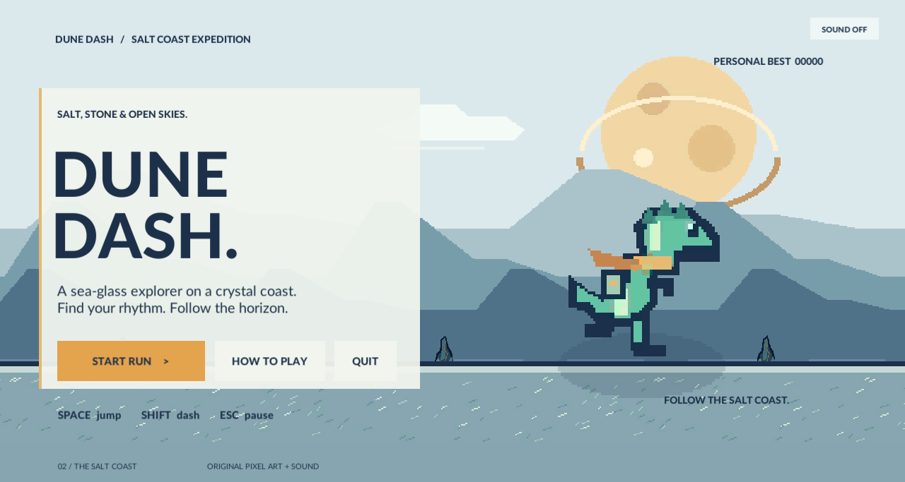
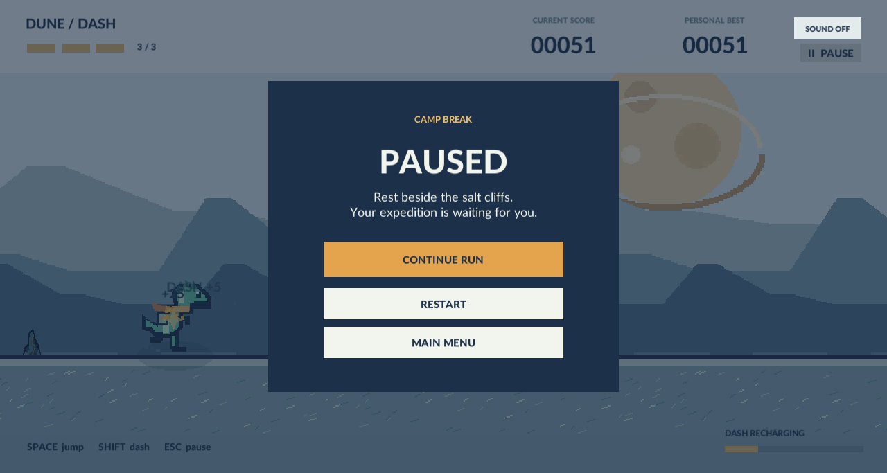
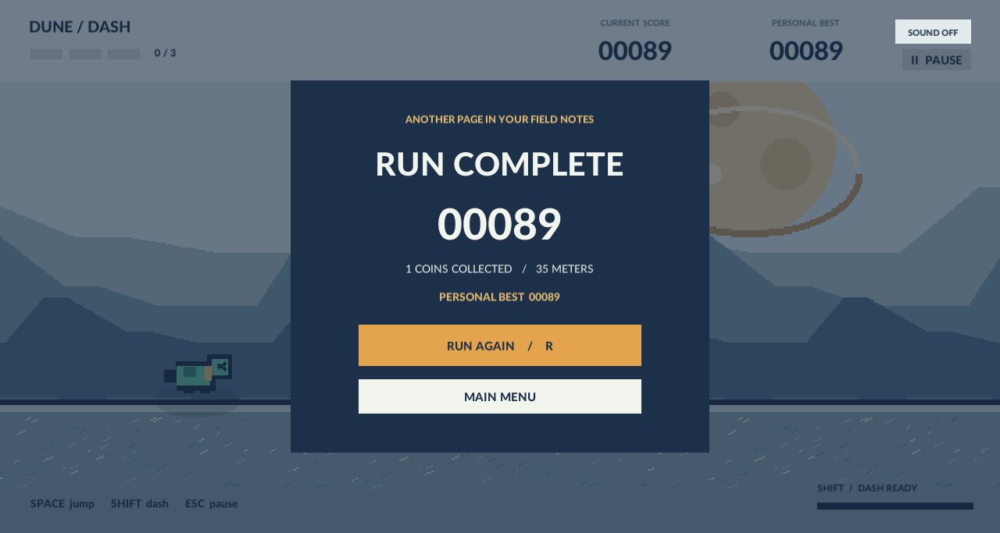

# گزارش پروژهٔ Dune Dash

نام و نام خانوادگی: امیرحسین قدردان
شمارهٔ دانشجویی: 401521489
درس: طراحی بازی‌های کامپیوتری — تمرین اول

مخزن پروژه: https://github.com/amhghadrdan/GD_Hw1_Amirhossein_Ghadrdan_401521489

## ایده و اجرا

Dune Dash یک رانر بی‌پایان دوبعدی با دایناسور کاوشگر، صخره‌های بلوری، پرندگان سفره‌ماهی‌مانند و سکه‌های تراش‌خورده است. طراحی هنری ساحل نمکی شامل کاراکتر سبزآبی با شال و کوله، ماه حلقه‌دار، سه لایهٔ صخرهٔ آبی، ابرها و کف نمکی متحرک است. لایه‌ها با سرعت‌های متفاوت حرکت می‌کنند تا Parallax واضح باشد. دشواری با مسافت افزایش می‌یابد و فاصلهٔ زمانی موانع حداقل یک پرش کامل را پوشش می‌دهد.

## تطبیق با صورت تمرین

| نیاز صورت تمرین | پیاده‌سازی |
|---|---|
| Unity و C# | پروژهٔ Unity 2022.3 LTS، اسکریپت‌ها در `Scripts` |
| پس‌زمینهٔ پویا و Parallax | `ParallaxLayer`؛ ابر، تپه‌های دور/میانی/نزدیک، گیاه و زمین |
| فقط New Input System | `RunnerControls.inputactions`، `PlayerInputRouter`، `InputSystemUIInputModule`؛ ورودی قدیمی استفاده نشده است |
| سه جان و Health Bar | `DinoController.Lives`، سه بخش رنگی و شمارندهٔ جان روی Canvas |
| پرش Space و Dash با Shift | Rigidbody2D برای پرش؛ Dash با شارژ، رد تصویری و شکستن مانع |
| آسیب و پایان در صفر جان | Trigger برخورد، کاهش یک جان، محافظت کوتاه، سپس Dying و GameOver |
| دو نوع مانع و یک آیتم | `GroundObstacle`، `FlyingObstacle` و `Coin` |
| پایهٔ مشترک Interactable | هر سه کلاس مستقیماً از کلاس abstract `Interactable` ارث می‌برند |
| Animator با چهار State | `Run`، `Jump`، `Hit`، `Death` همراه با Transition، کلیپ واقعی و پارامتر |
| تغییر رنگ هنگام آسیب | رنگ مرجانی و چشمک‌زدن طی محافظت؛ State Hit هم اجرا می‌شود |
| Main Menu و Pause Menu مستقل | دو ریشهٔ مستقل Canvas با شروع، ادامه، شروع مجدد و برگشت |
| Current Score و High Score زنده | دو Text مستقل روی HUD؛ رکورد در طول بازی هم به‌روز می‌شود |
| ماندگاری با PlayerPrefs | کلید `DuneDash.HighScore.v1`؛ ذخیره در پایان، توقف، منو و خروج |
| خلاقیت بصری | Pixel art اختصاصی، انیمیشن پاها و پرندگان، رد Dash، ذرات، سایه، لرزش دوربین، موسیقی و افکت |

## ساختار نرم‌افزار

`GameManager` ماشین حالت و مالک امتیاز و رکورد است. `DinoController` حرکت فیزیکی، جان، Dash و پارامترهای Animator را کنترل می‌کند. `Interactable` حرکت مشترک، خروج از صفحه و قرارداد تعامل را تعریف می‌کند؛ کلاس‌های فرزند رفتار آسیب یا پاداش را می‌سازند. `ObstacleSpawner` الگوی موانع و سکه‌ها را با فاصلهٔ قابل‌بازی تولید می‌کند.

`GameUI` روی Canvas اطلاعات زنده و منوها را می‌سازد. `AudioDirector` افکت‌ها و موسیقی را مدیریت می‌کند. `VisualEffects` برای ذرات کوتاه‌عمر و لرزش دوربین است. `GameBootstrap` ساخت محیط و اتصال اجزا را انجام می‌دهد. `ProjectBuilder` ابزار Editor برای تولید دارایی‌های سریال‌شده و خروجی مستقل است. این تقسیم مسئولیت، منطق گیم‌پلی را از رابط و تولید دارایی جدا می‌کند.

## آزمون

`RuntimeSmokeTests` با آرگومان `-smokeTest`، کیبورد مجازی New Input System می‌سازد و شروع، پرش، جلوگیری از پرش دوم، Dash، سکه، برخورد زمینی و هوایی، توقف، مرگ، رکورد و شروع مجدد را بررسی می‌کند. این تست از کلید موقت PlayerPrefs استفاده می‌کند تا رکورد واقعی بازیکن تغییر نکند. نتایج اجرای واقعی و تصاویر فقط پس از اجرای موفق در پوشهٔ `Documentation` قرار می‌گیرند؛ وجود کد آزمون به‌تنهایی به معنی پاس شدن آن نیست.

### نتیجهٔ اجرای واقعی

در ۲۶ مهر ۱۴۰۵، Build مستقل لینوکس با Unity 2022.3.62f1 ساخته و روی همین سیستم اجرا شد. **هر ۲۵ بررسی خودکار موفق بود**؛ شامل پیوستگی زمین پس از حرکت Parallax. خروجی تفصیلی در `test-results.txt` است. هفت تصویر این گزارش از همین فایل اجرایی گرفته شده‌اند. خروجی آزمون با کد صفر پایان یافت و خطای C# یا استثنای زمان اجرا ثبت نشد.

## تصاویر خروجی

پس از اجرای آزمون، تصاویر در `Screenshots` ذخیره می‌شوند:

- `01-main-menu.png`: منوی اصلی.
- `02-jump.png`: پرش و نمایش HUD.
- `03-dash.png`: حرکت سریع و رد تصویری.
- `04-pause.png`: منوی توقف.
- `05-hit.png`: آسیب و کاهش جان.
- `06-game-over.png`: پایان و رکورد.
- `07-gameplay.png`: نمای بازی، موانع و سکه‌ها.

## تحویل

فایل `.gitignore` اولیهٔ تمرین حفظ شده است. `Library`، `Temp`، `Builds` و داده‌های تولیدشدهٔ سنگین نباید به مخزن اضافه شوند. برای سامانهٔ درس فایل ZIP شامل لینک مخزن، کل پوشهٔ Build اجرایی و این گزارش به‌همراه تصاویر تهیه شود. الگوی نام فایل طبق صورت تمرین `GD_Hw1_[firstName]_[lastName]_[StudentId].zip` است. مخزن کد ایجاد و فایل‌های ضروری پروژه در آن ثبت شده‌اند؛ لینک مخزن در repository.txt و ابتدای این گزارش قرار دارد.

## بازیابی و خروجی ویندوز

در ۳ آبان ۱۴۰۵ پروژه از مخزن در Desktop/HM1 بازیابی شد. Build لینوکس دوباره هر ۲۵ آزمون را گذراند. Build ویندوز ۶۴ بیتی نیز با موفقیت در Builds/Windows/DuneDash.exe ساخته شد. فایل اجرایی و کتابخانه‌ها بررسی شدند؛ آزمون اجرای ویندوز در این سیستم لینوکس انجام نشده است. گزارش نهایی فقط به صورت PDF با چینش فارسی راست به چپ و لینک مخزن در بستهٔ تحویل قرار دارد.

## نسخهٔ ساحل نمکی و مخزن جدید

تصاویر کاراکتر، موانع زمینی و هوایی، آیتم امتیازی، پس‌زمینه و زمین با تم ساحل نمکی بازطراحی شدند و رنگ‌بندی رابط با آن‌ها هماهنگ شد. تاریخچهٔ Git حفظ شده و این طراحی به‌صورت یک تغییر جدید ثبت می‌شود. آدرس فعلی مخزن در حساب تأییدشدهٔ amhghadrdan در ابتدای گزارش و repository.txt درج شده است.
