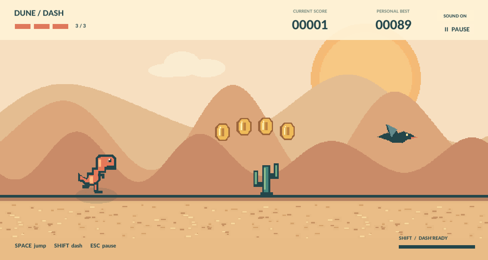

# Dune Dash — HM1

**امیرحسین قدردان — 401521489**

[مخزن GitHub](https://github.com/arminf267-cmyk/GD_Hw1_Amirhossein_Ghadrdan_401521489) · [گزارش PDF](Documentation/GD_Hw1_Amirhossein_Ghadrdan_401521489.pdf)



بازی دوبعدی دایناسور رانر مطابق صورت تمرین `HM1.pdf`، با طراحی پیکسلی بیابانی، صدای اختصاصی و پروژهٔ کامل Unity.

## نسخهٔ بازیابی‌شده

این پروژه در ۳ آبان ۱۴۰۵ در پوشهٔ `Desktop/HM1` بازیابی شد. خروجی ویندوز ۶۴ بیتی در `Builds/Windows` ساخته شده است؛ برای اجرا روی ویندوز `RunGame.bat` را باز کنید و تمام فایل‌های پوشهٔ Build را کنار هم نگه دارید. بستهٔ آمادهٔ تحویل در `Submission` فقط Build ویندوز، گزارش PDF فارسی و لینک مخزن را دارد.

نسخهٔ لینوکس نیز دوباره اجرا شد و هر ۲۵ آزمون آن موفق بود. خروجی ویندوز با Unity ساخته و فایل‌های آن بررسی شده‌اند؛ آزمون اجرای ویندوز روی این سیستم لینوکس انجام نشده است.

## اجرای مستقیم روی این سیستم

خروجی آمادهٔ لینوکس در `Builds/Linux` قرار دارد. از داخل این پوشهٔ پروژه اجرا کنید:

```bash
./RunGame.sh
```

برای اجرای فایل ساخته‌شده نیازی به باز بودن Unity یا داشتن مجوز ویرایشگر نیست. Build نهایی و هر ۲۵ بررسی گیم‌پلی روی همین سیستم موفق بوده‌اند. تصاویر واقعی در `Documentation/Screenshots` و جزئیات آزمون در `Documentation/test-results.txt` قرار دارند.

## اجرا در Unity

1. در **Unity Hub** وارد حساب خود شوید و یک مجوز معتبر Unity را فعال کنید؛ مجوز Personal برای افراد واجد شرایط رایگان است.
2. نسخهٔ **Unity 2022.3.62f1 LTS** را انتخاب کنید. برای خروجی لینوکس Mono، امکانات خود ویرایشگر کافی است؛ برای ویندوز ماژول **Windows Build Support (Mono)** لازم است.
3. از **Add → Add project from disk** همین پوشهٔ `HM1` را اضافه و باز کنید.
4. اولین بار اجازه دهید Package Manager بستهٔ **Input System 1.7.0** را نصب و کامپایل کند. نسخهٔ دقیق در `Packages/manifest.json` ثبت شده و Unity آن را از مخزن رسمی دریافت می‌کند. تنظیم **Active Input Handling** از قبل روی **Input System Package (New)** است.
5. فایل `Assets/DuneDash/Scenes/Desert.unity` را باز کنید و **Play** بزنید.

فایل‌های واقعی Prefab و Animator هنگام اولین ورود به ویرایشگر به‌طور خودکار ساخته می‌شوند. اگر لازم شد از منوی **Dune Dash → Generate or repair project assets** آن‌ها را بازسازی کنید. صحنه یک Bootstrap دارد و محیط، Canvas، EventSystem و اجزای بازی هنگام Play ساخته می‌شوند؛ خالی بودن نمای Scene پیش از Play طبیعی است.

در ویندوز، `OpenInUnity.bat` پروژه را باز می‌کند؛ `RunGame.bat` در صورت وجود Build ویندوز آن را اجرا می‌کند.

در لینوکس:

```bash
./RunGame.sh
# باز کردن پروژه در ویرایشگر:
./Tools/unity.sh open
# ساخت خروجی مستقل:
./Tools/unity.sh build
# اجرای آزمون تعاملی روی خروجی ساخته‌شده:
./Tools/unity.sh test
```

اگر ویرایشگر در مسیر دیگری نصب شده است:

```bash
UNITY_EDITOR=/path/to/Editor/Unity ./Tools/unity.sh open
```

## کنترل‌ها

| عمل | کیبورد | گیم‌پد |
|---|---|---|
| شروع / پرش | Space | A / دکمهٔ جنوبی |
| Dash | Shift چپ یا راست | X / دکمهٔ غربی |
| توقف / ادامه | Esc یا P | Start |
| شروع دوباره در توقف یا پایان | R | دکمهٔ منو در UI |
| منوها | ماوس، Tab و Enter | جهت‌ها و A |

**سه جان** دارید. هر برخورد یک جان کم می‌کند و ۱٫۳۵ ثانیه محافظت می‌دهد. Dash به مدت ۰٫۳۲ ثانیه سرعت را افزایش می‌دهد، برخورد با موانع را خنثی می‌کند و آن‌ها را می‌شکند؛ زمان شارژ ۲٫۲ ثانیه است. هر سکه **۲۵ امتیاز** و شکستن هر مانع **۵ امتیاز** دارد. امتیاز مسافت و سرعت به‌تدریج افزایش می‌یابند. پرندگان بلند را می‌توان از زیر رد کرد؛ برای پرندگان پایین از Dash یا پرش استفاده کنید.

دکمهٔ **SOUND ON/OFF** صدای موسیقی و افکت‌ها را با هم تغییر می‌دهد. خارج شدن فوکوس پنجره، بازی جاری را خودکار متوقف می‌کند. منوی توقف و منوی اصلی مستقل‌اند. رکورد هنگام توقف، برگشت به منو، پایان و خروج در `PlayerPrefs` ذخیره می‌شود.

## خروجی مستقل

از منوی **Dune Dash → Build Linux game** یا **Build Windows game** استفاده کنید. صحنه از قبل در Build Settings فعال است. خروجی‌ها در `Builds/Linux` و `Builds/Windows` قرار می‌گیرند. کل پوشهٔ خروجی، شامل فایل اجرایی، پوشهٔ Data و کتابخانه‌ها را کنار هم نگه دارید.

## فایل‌های مهم

- `Assets/DuneDash/Scripts/`: منطق بازی، کنترل، برخوردها، رابط و جلوه‌ها.
- `Assets/DuneDash/Editor/ProjectBuilder.cs`: تولید Prefab، Animator، کلیپ‌ها و Build.
- `Assets/DuneDash/Resources/RunnerControls.inputactions`: ورودی‌های New Input System.
- `Assets/DuneDash/Resources/Sprites/`: تصاویر پیکسلی اصیل، آمادهٔ استفاده و بدون نیاز به دانلود.
- `Assets/DuneDash/Resources/Audio/`: صداها و موسیقی تولیدشده برای این پروژه.
- `Tools/generate_assets.py`: بازتولید تصاویر و صداها؛ فقط برای توسعه به Python و Pillow نیاز دارد.
- `Documentation/REPORT.md`: گزارش کوتاه و تطبیق با صورت تمرین.
- `Documentation/SOURCES.md`: منابع و مجوز فونت‌ها و توضیح استفاده از ابزار کمکی.

بازی برای اجرا به Python نیاز ندارد. فایل‌های هنری و صوتی آماده در پروژه قرار دارند. برای دریافت اولیهٔ بستهٔ ورودی و فعال‌سازی ویرایشگر Unity، اینترنت لازم است. اجرای Build آماده به اینترنت نیاز ندارد.

## ساخت PDF فارسی

```bash
python3 Tools/create_pdf_report.py
```

این ابزار با Chrome یا Chromium و قلم فارسی نصب‌شده، گزارش را مستقیم به PDF راست‌به‌چپ با لینک قابل‌کلیک مخزن تبدیل می‌کند.

## بستهٔ تحویل

بعد از ساخت خروجی و ایجاد مخزن شخصی، ابزار زیر ZIP مطابق نام‌گذاری تمرین می‌سازد:

```bash
python3 Tools/package_submission.py --first-name NAME --last-name FAMILY --student-id ID --repository-url https://github.com/USER/REPO
```

این ابزار چیزی را در اینترنت منتشر نمی‌کند.
